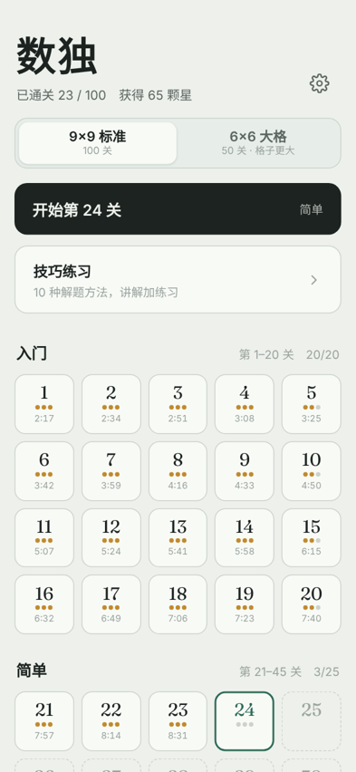
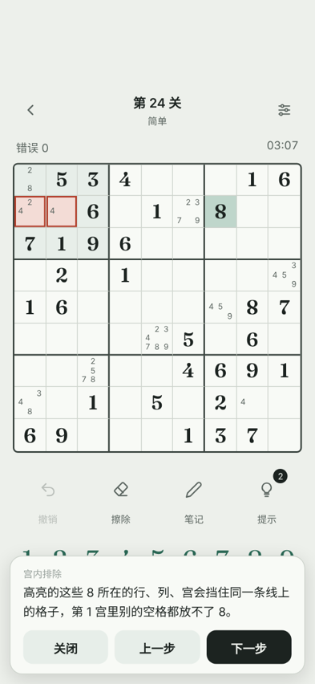
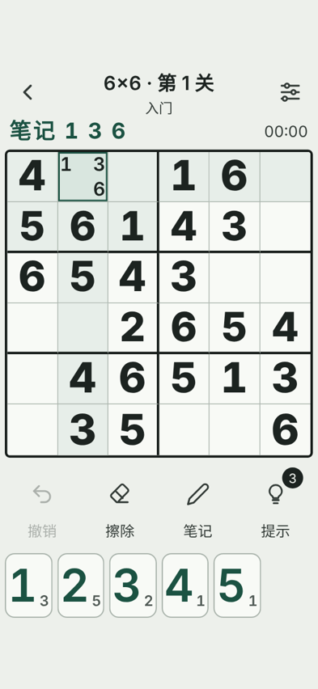
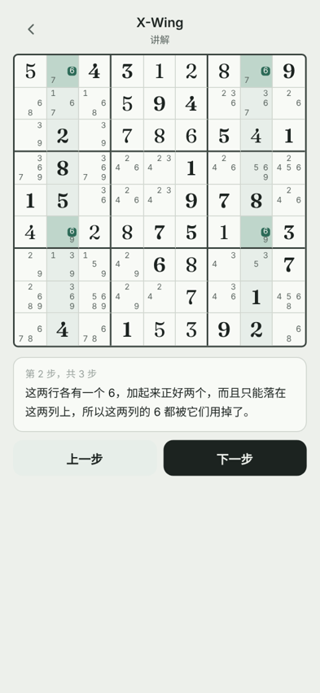

# Sudoku · 100 Levels

An offline Sudoku game for Android with 100 hand-ordered 9×9 levels, 50 large-cell 6×6 levels, a step-by-step **explaining hint system**, and a technique-practice section. It was designed so that elderly family members can play comfortably: there is a large-text mode, bigger cells, and protection against accidental double taps.

The whole game is a single HTML/CSS/JavaScript page, wrapped in a tiny Android WebView shell. No frameworks, no network access, no ads, no sound.

> The in-game text is in Simplified Chinese. A Chinese user guide is in [README.zh-CN.md](README.zh-CN.md).

<p>
  
  
  
  
</p>

## Features

**Levels**
- 100 levels of 9×9, ordered from easy to expert in five tiers. Each tier introduces new techniques:

  | Levels | Tier | Techniques needed |
  |---|---|---|
  | 1–20 | Beginner | Naked singles (40–46 givens) |
  | 21–45 | Easy | + Hidden singles in rows/columns (28–36 givens) |
  | 46–70 | Medium | Pointing / claiming, pairs |
  | 71–90 | Hard | Triples, X-Wing |
  | 91–100 | Expert | XY-Wing or XYZ-Wing in every level |

- 50 levels of 6×6 (2×3 boxes), with cells 1.5× larger than in 9×9. These use basic techniques only, with 24 down to 10 givens.
- Every puzzle has a unique solution and can be solved by pure logic, without guessing.
- Clearing a level unlocks the next one. Cleared levels can be replayed, and each level tile shows its best time and stars.

**Playing**
- Pencil marks are drawn inside the cell (3×3 grid, or 2×3 for 6×6). There is a note-mode toggle, and a long press on a number key does the opposite of the current mode.
- Undo (which also takes back the mistake count), erase, optional error highlighting, automatic note cleanup in the same row/column/box, and highlighting of identical digits.
- The timer starts on the first tap, pauses in the background, and can be hidden.
- Stars depend only on hints used: 0 hints = 3 stars, 1 = 2 stars, 2–3 = 1 star.

**Explaining hints (3 per level)**
- A hint first asks for confirmation, so it is not used up by mistake.
- It then explains the reasoning step by step, with highlighted cells and crossed-out candidates, and finally fills in the number.
- The hint engine finds the next deduction from the current board, then removes every elimination that does not contribute to it, so explanations stay short (at most 4 steps across all levels).
- Reopening a hint on an unchanged board, even after the app was restarted, does not cost another hint.
- If the selected cell is filled in wrong, the hint corrects it directly.

**Technique practice**
- 10 lessons: naked single, hidden single (box), hidden single (row/column), pointing/claiming, pairs, triples, X-Wing, XY-Wing, XYZ-Wing, swordfish.
- Each lesson has an animated walkthrough on a real board, 10 single-step drills checked by the engine, and 2 full puzzles that require the technique (unlimited hints).

**Accessibility (large-text mode)**
- The board fills the screen width and digits are bold and nearly fill each cell.
- Number keys are laid out in two rows, the notes of the selected cell are shown in large text above the board, and all text is about 1.5× larger.
- It switches on automatically when the Android system font scale is ≥ 1.15, until the player toggles it manually.
- Tuned for small and narrow screens, down to 260 CSS px wide.

**Robustness**
- Progress is saved after every move. After the system kills the app, it returns to the same game.
- Corrupted or old save data never prevents the app from starting.
- Double-tap protection: when a tap changes the screen or opens/closes a panel, a second tap at the same spot is ignored for 0.4–0.75 s. Fast taps that don't change the UI, such as entering notes quickly, are never blocked.
- The Android back button closes panels first, then goes back one screen, then exits.
- If the WebView renderer is killed in the background, the page is reloaded instead of crashing.

## Tech stack

| Part | Technology |
|---|---|
| Game UI and logic | Plain HTML + CSS + JavaScript in one file (`web/src.html`) |
| Solving / hint engine | JavaScript (`web/engine.js`): technique finders, step-by-step explanation frames, hint-chain pruning; works for 9×9 and 6×6 |
| Puzzle generation | Python (`gen/generate.py`) for the 9×9 levels, Node.js (`gen/gen6.js`, `gen/gen_lessons.js`) for 6×6 and lessons |
| Android app | Java `Activity` with a `WebView` (`android/`), Gradle 8 / Android Gradle Plugin 8.7, minSdk 24 (Android 7.0), targetSdk 34 |
| Tests | Playwright (Python, headless Chromium) for UI tests, plus Node.js scripts for the engine and puzzle data |

## Project structure

```
web/
  src.html        Game (UI + logic). Placeholders /*PUZZLES*/ /*PUZZLES6*/ /*ENGINE*/ /*LESSONS*/ are filled at build time
  engine.js       Technique engine and hint explanations
  fonts/          Fraunces (digits), SIL Open Font License 1.1
gen/
  generate.py     9×9 puzzle generator and grader → puzzles.json, puzzles_report.json
  gen6.js         6×6 generator → puzzles6.json
  gen_pool.py, gen_lessons.js   Technique-practice data → lessons.json
android/          Android WebView shell (Gradle project)
build.py          Builds web/index.html and copies it into the Android assets
make_preview.py   Builds a stand-alone preview page for desktop browsers
tests/            Playwright UI tests and engine/data checks
```

## Getting started

### Play in a browser

```bash
python build.py          # writes web/index.html and copies it to android/app/src/main/assets/www/
```

Then open `web/index.html` in a browser, using the phone-size view in the developer tools for the best result. `python make_preview.py` additionally writes `preview_full.html`, which has the fonts embedded.

### Build the Android APK

Requirements: JDK 17, the Android SDK (platform 34, build-tools), and Python 3.

```bash
python build.py
cd android
echo "sdk.dir=/path/to/Android/sdk" > local.properties
./gradlew assembleRelease          # Windows: gradlew.bat assembleRelease
```

Without signing configuration this produces `app/build/outputs/apk/release/app-release-unsigned.apk`. To build a signed APK, create `android/keystore.properties`. This file is ignored by git, so never commit it or the keystore:

```properties
storeFile=your-release-key.jks
storePassword=...
keyAlias=...
keyPassword=...
```

To generate a key, run `keytool -genkeypair -v -keystore your-release-key.jks -keyalg RSA -keysize 2048 -validity 10000 -alias yourAlias`. Keep the keystore safe: an update only installs over an existing install (keeping progress) if it is signed with the same key.

### Regenerate puzzles (optional)

The committed `gen/*.json` files are the puzzles used in the app. Regenerating replaces them with a new random set, and the 9×9 generator can take a while.

```bash
cd gen
python generate.py           # 9×9 levels → puzzles.json, puzzles_report.json
node gen6.js                 # 6×6 levels → puzzles6.json
python gen_pool.py 32000     # candidate pool for the lessons → pool.json (large, not committed)
node gen_lessons.js          # technique-practice data → lessons.json
cd .. && python build.py
```

### Run the tests

```bash
pip install playwright && python -m playwright install chromium
python build.py

# UI tests (each takes the built page as argument)
python tests/review1_test.py web/index.html
python tests/regression_test.py web/index.html
python tests/learn_ui_test.py web/index.html
python tests/six_ui_test.py web/index.html
# … also edge_test, compat_test, tiles_test, feedback_test, large_mode_test, large_layout_test

# Randomised model-based test: page, runs, steps per run, seed (MODE=9 or 6)
MODE=9 python tests/model_test.py web/index.html 40 150 1

# Engine and data checks
node tests/engine_test.js
node tests/engine6_test.js
node tests/hint_quality_test.js
python tests/six_verify.py
python tests/lessons_verify.py sols.json && node tests/lessons_test.js "$PWD/sols.json"
```

## How it was made

This project was built together with an AI assistant (Claude by Anthropic). The design, feature requests and play-testing came from me and my family; the AI wrote the code and ran repeated automated review rounds.
